# Class diagram — model-adm1 from a software point of view

Five small classes, one model class, one entry script and a bag of pure functions. The only inheritance
is `ADM1(OdeModel)` (model.py): the contract of stamm-model-core, which runs the simulation loop and
writes the run package. Configuration (YAML) is the source of truth; the classes are thin readers around
it, and `ADM1Reactor` is the only object with real logic (the 38 ODEs).

```mermaid
classDiagram
    direction LR

    class main {
        <<script>>
        +main(--scenario, --influent-hold, ...)
        +output_times()
        +influent_record() dict
        +hybrid_record() list
        +make_plots()
    }

    class ADM1 {
        <<model.py, OdeModel>>
        +states : 29 names
        +influent_hold : start / end / legacy
        +initial_state(x0, p) dict
        +derived_parameters(p) dict
        +breakpoints(t0, t1) list
        +before_segment(t0, t1)
        +rhs(t, y, p, u) dydt
        +post_columns(columns, p) dict
        +result_warnings(columns, p) list
    }

    class run_scenario {
        <<stamm-model-core>>
        continuous mode: solve_ivp per piece
        results CSV, run package, validation
    }

    class ADM1Parameters {
        +params : dict
        +params_file : str
        +scenarios_file : str
        +__getattr__(name) float
        +get(name, default) float
        -_load()
        -_load_scenario_overrides() dict
        -_flatten(yaml) dict
    }

    class InitialState {
        +state_dict : dict
        +get_vector() ndarray
        +get_dict() dict
        -_load()
    }

    class Influent {
        +mode : str
        +get(step) dict
        +get_time() ndarray
        -_data : DataFrame
        -_constant_values : dict
        -_flow_col : str
    }

    class ADM1Reactor {
        +param : ADM1Parameters
        +influent_state : dict
        +use_xc : bool
        +gas_law_patm : bool
        +f_sI_xb f_ch_xb f_pr_xb f_li_xb f_xI_xb
        +K_H_co2 K_H_ch4 K_H_h2 p_gas_h2o
        +K_pH_aa nn_aa K_pH_ac n_ac K_pH_h2 n_h2
        +rate_overrides : dict
        +inhibition_overrides : dict
        +residual_correction : callable
        +ADM1_ODE(t, y) dydt
        +compute_inhibitions(state) dict
        +compute_biochemical_rates(state, inhib) dict
        +compute_gas_transfer(state) dict
        +mass_balances(state, rho, gas) list
        +get_process_summary() dict
        +unpack_state(y) dict
        +reduce_to_dynamic_state(y38) y29
        +expand_dynamic_state(y29) y38
    }

    class acid_base {
        <<module>>
        +compute_acid_base_equilibrium(state, param) dict
        +compute_required_strong_ion_for_pH(state, param, pH) float
        +compute_total_cod(state, param) dict
        -_charge_balance(H, state, param)
    }

    class ModelEntry {
        <<dataclass>>
        +name : str
        +target : str
        +backend : str
        +artefact : str
        +inputs : list
    }

    class registry {
        <<module>>
        +load_registry(models_dir) dict
        +format_registry(registry) str
        +format_hooks() str
    }

    class hybrid {
        <<module>>
        +apply_hybrid_config(reactor, cfg, registry) dict
        +load_callable(spec) callable
        -_compile_entry(entry) callable
        -_load_artefact(backend, path)
    }

    class plots {
        <<module>>
        +plot_biogas(df, param)
        +plot_biomass(df)
        +plot_pH_alkalinity(df, param)
    }

    class solve_ivp {
        <<scipy>>
    }

    class configs {
        <<YAML>>
        scenarios.yaml
        parameters.yaml
        initial_states.yaml
        influent.yaml
        simulation.yaml
        states.yaml
        outputs.yaml
        model_card.yaml
    }

    main --> InitialState : builds (param from_values)
    main --> Influent : builds (param from_values)
    main --> registry : load_registry()
    main --> ADM1 : builds
    main --> run_scenario : runs the scenario
    main --> plots : after the run
    run_scenario --> solve_ivp : per piece
    solve_ivp ..> ADM1 : calls rhs(t, y)
    ADM1 --> ADM1Reactor : builds in initial_state()
    ADM1 --> hybrid : apply_hybrid_config()
    ADM1 ..> acid_base : post_columns()
    ADM1Reactor o-- ADM1Parameters : param
    ADM1Reactor ..> acid_base : every RHS call
    ADM1Reactor ..> Influent : influent_state (row set by ADM1)
    registry ..> ModelEntry : creates
    hybrid ..> ModelEntry : compiles
    hybrid ..> ADM1Reactor : sets overrides and residual_correction
    InitialState ..> acid_base : S_anion from a pH
    Influent ..> acid_base : constant feed with pH key
    ADM1Parameters ..> configs : parameters.yaml + scenarios.yaml
    InitialState ..> configs : initial_states.yaml + scenarios.yaml
    Influent ..> configs : influent.yaml + scenarios.yaml + CSV
    registry ..> configs : models yaml files

```



## Reading guide

* **`scenarios.yaml` is the switchboard**, the scenario is chosen with `python main.py --scenario <key>`.
  `main.py` resolves the parameters with stamm-model-core (`parameters.yaml` + the scenario's
  `parameter_overrides`, T_op included) and hands them to `InitialState` and `Influent`
  (`scenario_key=`, `param=ADM1Parameters.from_values(...)`), which pick their own block
  (`initial_states` / `influent_mode`). They never talk to each other.
* **`ADM1Parameters` is a flat `dict` with attribute access** (`param.k_dis`, `param.use_xc`). The reactor
  also *writes* into it (`K_w`, `K_a_co2`, `K_a_IN` recomputed from `T_op`, reported in run.json with
  source "computed"; `q_ad` updated per feed row when the influent has a flow column).
* **`ADM1Reactor` is stateless between calls** except for the `influent_state` dict that `ADM1.rhs` sets
  before every RHS evaluation (the row held over the current piece) and the `_last_*` caches. `ADM1_ODE` is the pipeline
  `acid_base → inhibitions → rates → gas → mass_balances`, with the three hybrid hook points in between.
* **Two state vectors.** The solver integrates 29 dynamic states (`y29`); the reactor works on the full
  38 (`y38`), the 9 acid–base states being recomputed algebraically at each call
  (`reduce_to_dynamic_state` / `expand_dynamic_state` convert).
* **`use_xc`** lives in `ADM1Parameters` (YAML) and is read once at reactor construction into
  `ADM1Reactor.use_xc`; it changes `Rho_1` and the decay routing in `mass_balances`.
* **`gas_law_patm`** is read the same way into `ADM1Reactor.gas_law_patm`; it only changes `q_gas` in
  `compute_gas_transfer` (and the same law in `compute_gas_flow_rate` / `compute_gas_outputs`, which
  produce the `q_gas*` CSV columns and the biogas plot).
* **Hybrid layer** = `registry` (reads `models/*.yaml` → `ModelEntry`) + `hybrid` (turns an entry into a
  Python callable and plugs it into `rate_overrides`, `inhibition_overrides` or `residual_correction`).
  With no `adm1_hybrid:` block in the scenario the reactor is pure ADM1.

## One simulation, as a sequence

```mermaid
sequenceDiagram
    autonumber
    participant M as main.py
    participant C as stamm-model-core
    participant D as ADM1 (model.py)
    participant P as ADM1Parameters
    participant S as InitialState
    participant I as Influent
    participant R as ADM1Reactor
    participant A as acid_base
    participant H as registry / hybrid
    participant O as scipy.solve_ivp

    M->>C: load_config + apply_overrides (parameters of the scenario)
    M->>S: InitialState(scenario_key, param)  (initial set, S_anion from pH)
    M->>I: Influent(scenario_key, param)       (CSV or constant block)
    M->>C: run_scenario(ADM1, t_out, solver, influent record, ...)
    C->>D: initial_state(x0, p)
    D->>R: ADM1Reactor(param) - T constants, use_xc, f_xb
    D->>H: apply_hybrid_config(reactor, adm1_hybrid)
    H-->>R: rate_overrides / inhibition_overrides / residual_correction
    D->>A: compute_acid_base_equilibrium(y0) - consistent ions at t=0
    D-->>C: y0 (29 states); derived_parameters: K_w, K_a_co2, K_a_IN
    loop each piece between two influent rows (breakpoints)
        C->>D: before_segment(t_i, t_i+1) - the row held over the piece
        C->>O: solve_ivp(rhs, (t_i, t_i+1), y, BDF)
        loop each RHS evaluation
            O->>D: rhs(t, y29)
            D->>R: influent_state = row, param.q_ad = Q of the row
            D->>R: ADM1_ODE(t, y29)
            R->>A: compute_acid_base_equilibrium(state) - pH, ions
            R->>R: inhibitions, rates, gas transfer, 38 mass balances + residual
            R-->>O: dydt (29)
        end
    end
    C->>D: post_columns - acid-base, pH, COD, biogas on every output row
    C->>D: result_warnings - negative concentrations
    C->>C: results/dynamic_out.csv, runs/run_id.zip, validation
    M->>M: figures
```
